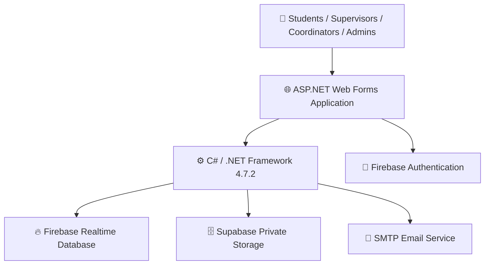
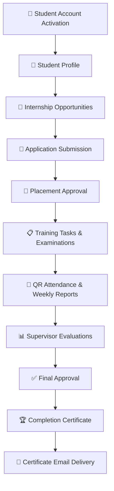

# 🎓 University Internship Management System (UIMS)

<div align="center">

### Bridging Academic Learning and Professional Experience

**A comprehensive, secure, and intelligent internship management platform built for Jordan University of Science and Technology (JUST).**

*Empowering students, universities, and companies through a unified digital internship ecosystem.*


**[🎨 UI/UX Design on Figma](https://www.figma.com/design/hJQBMCHmbrxP7dsgK8ZnjI/UIMS-%C2%B7-Wireframes--Mockups---Prototype?node-id=5-2) · [📋 Project Management on Trello](https://trello.com/b/tls65C3g/uims-university-internship-management-system)**

</div>

---

## 🌟 Project Overview

The **University Internship Management System (UIMS)** is a full-featured web application designed to digitize, automate, and streamline the entire university internship lifecycle.

Developed for **Jordan University of Science and Technology (JUST)**, UIMS replaces fragmented manual processes with a centralized, role-based platform connecting students, companies, academic supervisors, internship coordinators, and administrators.

From discovering internship opportunities and submitting applications to completing practical assignments, taking real examinations, tracking attendance, receiving evaluations, and obtaining completion certificates, UIMS brings the entire journey into one integrated ecosystem.

The system combines **ASP.NET Web Forms, C#, Firebase, Supabase, and SMTP email services** to deliver a structured, scalable, and secure academic internship experience.

### 🎯 Our Mission

> Transform university internships into a transparent, measurable, collaborative, and fully digital experience where every participant can track progress, fulfill responsibilities, and achieve meaningful outcomes.

---

## ✨ Key Features

### 🎓 Student Experience

- 🔐 Secure authentication and personalized student dashboard.
- 👤 Student profile management and academic information.
- 🔎 Browse available internship opportunities.
- 📝 Submit and track internship applications.
- 🏢 Review and accept internship placements.
- 📋 Access assigned training tasks and deadlines.
- 🧠 Take interactive examinations with real grading.
- 📱 Record attendance through QR-based workflows.
- 📅 Submit weekly training reports.
- ⏱️ Track completed internship hours and progress.
- 📊 View academic and company evaluations.
- 🏆 Receive internship completion certificates.

### 🏢 Company Supervisor Portal

- 👥 Manage assigned trainees.
- 📌 Create and assign practical training tasks.
- 📚 Monitor task submissions and progress.
- 🧪 Manage training assessments and examinations.
- 📈 Evaluate student performance.
- 📝 Provide professional feedback and evaluations.
- 🤝 Coordinate internship activities with the university.

### 👨‍🏫 Academic Supervisor Portal

- 📊 Monitor assigned students and training progress.
- 📖 Review weekly reports and completed hours.
- 📝 Evaluate academic and practical performance.
- 🔍 Track internship milestones and requirements.
- ✅ Participate in final internship evaluations and approvals.

### 🗂️ Internship Coordinator Portal

- 🌐 Monitor internship placements across companies.
- 📈 Track student participation and completion.
- 🏢 Oversee university-company coordination.
- 📊 Access centralized progress monitoring.
- 🚦 Identify pending internship requirements.

### 🛡️ Administration Portal

- 👤 Manage student and supervisor accounts.
- 🏢 Manage participating companies.
- 🔑 Handle account access and password resets.
- 🔒 Enable or disable user accounts.
- 🧩 Maintain role-based access control.
- ⚙️ Oversee internship management operations.

---

## 🚀 Advanced System Capabilities

| Feature | Description |
|---|---|
| 🔐 **Firebase Authentication** | Secure user authentication and identity management |
| 🔥 **Firebase Realtime Database** | Centralized cloud-based application data |
| 🗄️ **Supabase Private Storage** | Protected storage for internship documents and uploaded files |
| 📧 **SMTP Email Integration** | Automated email communication and notifications |
| 🏆 **Email Certificate Delivery** | Internship completion certificates delivered through email |
| 🧠 **Real Examinations** | Interactive assessments with questions, answers, grading, and results |
| 📱 **QR Attendance** | QR-based internship attendance tracking |
| 📊 **Progress Monitoring** | Tracking of training hours, milestones, and completion status |
| 📝 **Weekly Reports** | Structured student reports and academic review |
| 📋 **Task Management** | Assignment, submission, review, and evaluation workflows |
| 👥 **Role-Based Access Control** | Dedicated permissions and functionality for each user role |
| 🔄 **Application Tracking** | Internship application and placement lifecycle management |

---

## 🧠 Interactive Examination System

UIMS includes a functional examination module designed to assess student learning and practical knowledge.

**Assessment capabilities include:**

- Multiple-choice questions (MCQ).
- True/False questions.
- Configurable examination duration.
- Time-limited assessments.
- Configurable passing scores.
- Attempt restrictions.
- Automatic grading of objective questions.
- Examination results and performance tracking.
- Integration with internship training tasks.

This module helps supervisors measure student knowledge through structured assessments rather than relying exclusively on manual evaluation.

---

## 🏆 Digital Certificates & Email Automation

UIMS supports the final stage of the internship journey through digital certificate delivery.

Once the required internship completion and approval conditions are satisfied, the certificate workflow enables students to receive their completion documents electronically.

**Integrated capabilities:**

- Internship completion workflow.
- Digital completion certificates.
- SMTP-based email delivery.
- Automated communication.
- Reduced manual administrative work.

---

## 🏗️ System Architecture



### Technology Stack

| Layer | Technologies |
|---|---|
| Frontend | HTML5, CSS3, JavaScript, ASP.NET Web Forms |
| Backend | C#, ASP.NET, .NET Framework 4.7.2 |
| Authentication | Firebase Authentication |
| Database | Firebase Realtime Database |
| File Storage | Supabase Private Storage |
| Email Services | SMTP |
| Development IDE | Visual Studio |
| Local Web Server | IIS Express |
| Version Control | Git & GitHub |
| UI/UX Design | Figma |
| Agile Management | Scrum & Trello |

---

## 🔄 Internship Lifecycle



---

## 🎨 UI/UX Design

UIMS is designed around a clean, professional, university-oriented interface with role-specific dashboards and intuitive navigation.

Our design goals include:

- Consistent visual identity inspired by JUST.
- Organized dashboard layouts.
- Clear navigation between internship activities.
- Responsive interface design.
- Accessible forms and readable information.
- Consistent components and interaction patterns.
- User-focused workflows for every role.

### Explore Our Design

[🎨 View UIMS Wireframes, Mockups & Prototype on Figma](https://www.figma.com/design/hJQBMCHmbrxP7dsgK8ZnjI/UIMS-%C2%B7-Wireframes--Mockups---Prototype?node-id=5-2)

---

## 👨‍💻 Meet the Development Team

<div align="center">

### The People Behind UIMS

*Seven team members. One shared vision. One integrated platform.*

</div>

| Team Member | Scrum Role | Responsibilities |
|---|---|---|
| **Tariq Batayneh** | 🟣 Scrum Master | Scrum facilitation, team coordination, impediment management, development |
| **Roa Al-Ajlouni** | 🔵 Product Owner | Product vision, backlog prioritization, requirements, stakeholder alignment |
| **Yasmin Talafha** | 🟢 QA Engineer | Quality assurance, functional testing, defect reporting, validation |
| **Mohammad Mustafa** | 💻 Developer | Application development, feature implementation, integration |
| **Eyad Mansour** | 💻 Developer | Application development, feature implementation, integration |
| **Anas Ghawanimah** | 💻 Developer | Application development, feature implementation, integration |
| **Diaa Al-Wardat** | 💻 Developer | Application development, feature implementation, integration |

### 🤝 Our Development Methodology

The project follows the **Scrum framework**, emphasizing collaboration, iterative development, continuous feedback, and quality delivery.

Our workflow includes:

- Product backlog management.
- Sprint planning and task distribution.
- Feature development and integration.
- Continuous testing and issue resolution.
- Sprint reviews and improvements.
- Collaborative task tracking using Trello.

[📋 Explore Our Trello Project Board](https://trello.com/b/tls65C3g/uims-university-internship-management-system)

---

## 📁 Project Structure

```text
University-Internship-Management-System/
│
├── University-Internship-Management-System.slnx
│
├── University-Internship-Management-System/
│   ├── ASP.NET Web Forms Pages
│   ├── C# Application Logic
│   ├── Frontend Assets
│   └── Application Configuration
│
├── Tools/
│   └── Configure-Shared-Firebase.ps1
│
├── firebase-final-rules.json
│
├── Firebase / Storage Rules
│
└── README.md
```

*The diagram summarizes the main project components. Individual application files and directories are maintained within the source project.*

---

## ⚙️ Installation & Setup

### Prerequisites

Before running the application, ensure you have:

- Visual Studio with ASP.NET web development support.
- .NET Framework 4.7.2.
- NuGet package restore support.
- IIS Express.
- Authorized access to the team's Firebase project.
- Required local Firebase configuration.
- Supabase private storage configuration.
- SMTP configuration for email functionality.

### 1. Clone the Repository

```bash
git clone <YOUR-REPOSITORY-URL>
```

### 2. Open the Solution

Open the following solution in Visual Studio:

```text
University-Internship-Management-System.slnx
```

### 3. Restore Dependencies

Restore the required NuGet packages and build the web project.

### 4. Configure Firebase

Maintain the required per-device Firebase configuration and credentials.

The project includes:

```text
Tools/Configure-Shared-Firebase.ps1
```

To validate an existing local configuration, use the helper's `-ValidateOnly` option according to the team's setup procedure.

### 5. Configure Supabase

Set the required secret in the server environment:

```text
UIMS_SUPABASE_SECRET_KEY
```

Ensure the application is configured to use the designated private Supabase storage bucket.

**Never expose the Supabase secret key in client-side code or commit it to GitHub.**

### 6. Configure Email Services

Configure the required SMTP settings and credentials in the approved local or server environment.

### 7. Run the Application

Launch the project using **IIS Express** from Visual Studio.

Use the team's existing authorized accounts and shared Firebase environment.

> **Important:** Access to the shared backend requires team authorization. Cloning the repository alone does not provide access to private credentials, stored files, or database contents.

---

## 🔒 Security & Configuration

Security is an important part of the UIMS architecture.

The application uses:

- Firebase Authentication for user identity.
- Role-based application authorization.
- Firebase security rules.
- Private Supabase file storage.
- Server-side storage credentials.
- Controlled account management.
- Dedicated local configuration.
- Environment-based secrets.

### Repository Security

The following are intentionally excluded from version control:

- Local Firebase configuration.
- Private Firebase credentials.
- Supabase secret keys.
- SMTP passwords.
- QR signing secrets.
- Build outputs.
- Local verification artifacts.

Database and Storage contents are managed independently from the Git repository.

---

## 📌 Project Objectives

UIMS aims to:

1. **Digitize** the complete university internship lifecycle.
2. **Centralize** student, company, and academic interactions.
3. **Automate** repetitive administrative processes.
4. **Improve transparency** through progress and status tracking.
5. **Measure learning outcomes** using practical tasks and examinations.
6. **Simplify evaluations** for academic and company supervisors.
7. **Improve accessibility** to internship opportunities and information.
8. **Streamline completion** through final approvals and digital certificates.

---

## 🔮 Future Enhancements

Potential directions for future development include:

- AI-powered internship recommendations.
- Advanced analytics and performance forecasting.
- Mobile application integration.
- Automated internship opportunity matching.
- Expanded reporting and data visualization.
- Additional university integrations.
- Advanced certificate verification.
- Intelligent student performance insights.

*These are potential future enhancements, not claims about currently implemented features.*

---

## 🏫 Academic Context

**Institution:** Jordan University of Science and Technology (JUST)

**Faculty:** Faculty of Computer & Information Technology

**Project:** University Internship Management System

**Development Approach:** Agile / Scrum

**Team Size:** 7 Members

---

<div align="center">

### 💙 Built with Passion, Collaboration & Innovation

**From Internship Applications to Professional Achievement.**

*One Platform. Every Internship. Endless Opportunities.*

**UIMS — Connecting Education with Industry.**

---

**Developed by the UIMS Team**

🎓 Jordan University of Science and Technology

[🎨 Figma](https://www.figma.com/design/hJQBMCHmbrxP7dsgK8ZnjI/UIMS-%C2%B7-Wireframes--Mockups---Prototype?node-id=5-2) | [📋 Trello](https://trello.com/b/tls65C3g/uims-university-internship-management-system)

</div>
